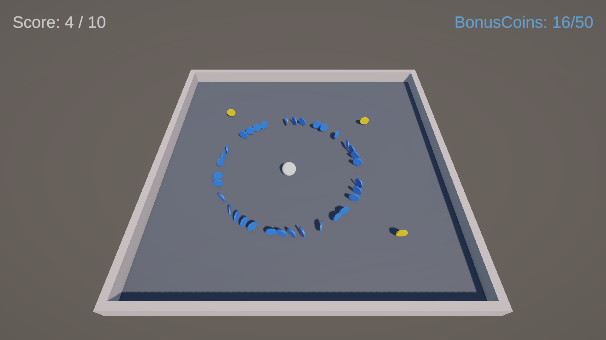

# ITU-CS-464-LAB-05-BSCS23051

**Course:** CS-464 Game Development, Information Technology University
**Lab 05:** Roll-a-Ball (Lecture 06: Physics, Forces & Collectibles)
**Name:** Muhammad Talha
**Roll number:** BSCS23051

## The game

Roll the ball with **WASD** or the arrow keys and collect the gold coins. Collect 10 to win; **Restart** starts a new game.

It is the Lecture 06 collect-a-thon, built from its four scripts:

| Script | What it does |
|---|---|
| `PlayerController.cs` | Pushes the ball with `AddForce` every physics step. Input is read in `Update` from the Input System's Move action and clamped so diagonals aren't faster. |
| `Spawner.cs` | `InvokeRepeating` drops a gold coin every 1.5 s at a random spot, at most 5 at a time, and never within 2 m of the player. |
| `Coin.cs` | Spins, and on `OnTriggerEnter` with the Player tag reports to the GameManager and destroys itself. |
| `GameManager.cs` | Owns the score, the text, the win panel (`Time.timeScale = 0`) and the restart (`timeScale` back to 1 first). |

## The three tasks

**1. One red coin at a random score.** At the start of the game, `GameManager` picks `redCoinScore = Random.Range(1, 10)`, so a score from 1 to 9. When the score reaches exactly that number, it spawns one `RedCoin` somewhere in the arena, away from the player. The score only goes up by 1 at a time, so it hits that number once and only one red coin ever spawns. It stops at 9 so the coin can still be collected before the win at 10 freezes the game.

**2. Fifty blue coins in a circle.** Collecting the red coin calls `CollectRedCoin()`. That spawns 50 `BlueCoin`s on a circle of radius 5 m around the player, one every 360° / 50 = 7.2°, using `cos` and `sin` of the angle. Coins that would land outside the walls are clamped inside the arena.

**3. The hidden BonusCoins text.** `BonusText` sits in the Canvas but starts inactive. When the blue coins appear, it is switched on showing `BonusCoins: 0/50`. Each blue coin collected adds one, so it counts up to `BonusCoins: 50/50`. Blue coins don't count towards the score of 10.

All three coins use the same `Coin` prefab setup: a trigger Sphere Collider and `Coin.cs`, with a `kind` field (Gold, Red or Blue) that decides what the GameManager is told.

## Project

- Unity 6.3 (6000.6.3f1), Universal 3D template
- Scene: `Assets/Scenes/SampleScene.unity`
- Prefabs: `Assets/Prefabs/Coin`, `RedCoin`, `BlueCoin`
